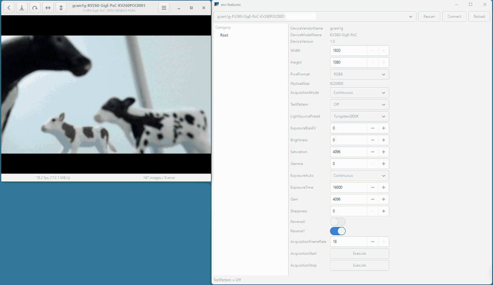

# gcam1g: an FPGA Ethernet camera on the Kria KV260

## What this is

`gcam1g` turns an AMD Kria KV260 into an Ethernet camera for
[Aravis](https://github.com/AravisProject/aravis). Like the cameras Aravis talks to, it
streams video with the GigE Vision protocol and describes its features in a GenICam XML
file. The FPGA fabric (PL) builds complete video packets, headers included, and writes them
into DDR. The application on the ARM cores (PS) only handles the control protocol and sends
the finished packets out.

Measured on hardware with Aravis, it streams 1920x1080 RGB8 at 18 fps (about 900 Mbps).

The control protocol (GVCP) runs on the PS because it has to: the KV260's Ethernet port is
wired to the PS, and the PL has no network interface of its own.

## What you need

- An AMD Kria KV260 Vision AI Starter Kit with the AMD official KV260 Ubuntu image.
- A 1 GbE connection to the viewing host, on the same subnet. The camera stream needs
  jumbo frames; the test pattern also works on a standard 1500-byte network (see
  [Standard 1500-byte networks](#standard-1500-byte-networks)).
- Aravis 0.8 on the viewing host (see [Viewing the stream](#viewing-the-stream)).
- Optionally, a camera module: onsemi AR1335 sensor with an AP1302 ISP. Without one, use
  the built-in test pattern; see [Without a camera module](#without-a-camera-module).

To build from source you also need a Linux host, Vivado 2024.2 with the Kria KV260 board
files (from the Xilinx board store), `g++-aarch64-linux-gnu` and `device-tree-compiler`.

## Prebuilt binaries

`prebuilt/gcam1g-kv260-v0.1.0.tar.gz` contains everything the board needs, so you can skip
building. To build it yourself, run `./build.sh`.

## Quick start (no Vivado)

1. Write the AMD official KV260 Ubuntu image to an SD card and boot the board.
2. Copy `prebuilt/gcam1g-kv260-v0.1.0.tar.gz` to the board.
3. Install a compiler (the stock image has none), then extract and install:

   ```sh
   sudo apt install build-essential linux-headers-$(uname -r)
   tar xzf gcam1g-kv260-v0.1.0.tar.gz
   sudo ./install.sh
   ```

   `install.sh` loads the bitstream, applies the camera overlay (and carries on with the
   test pattern only if no camera answers), builds and loads the `u-dma-buf` driver, and
   installs the launcher `gcam1g-run`.

4. Set the MTU to 9000 on the board, and on the viewing host for the camera stream:

   ```sh
   sudo ip link set eth0 mtu 9000
   ```

   The setting is lost on reboot.

5. Start streaming:

   ```sh
   sudo gcam1g-run          # camera
   sudo gcam1g-run --tpg    # test pattern, no camera needed
   ```

6. Run `arv-viewer-0.8` on the host. The device appears as
   `gcam1g-KV260-GigE-PoC-KV260POC0001`.

A reboot clears the PL, the camera overlay and the `u-dma-buf` driver. Run
`sudo ./install.sh` again before `gcam1g-run`. To keep the driver loaded across reboots, see
[`sw/driver/UDMABUF_BUILD.md`](sw/driver/UDMABUF_BUILD.md).

## Without a camera module

`sudo gcam1g-run --tpg` streams a test pattern generated in the PL, at 1920x1080, through
the same data path as the camera. It never touches the camera bus, so it works on a bare
board.

Choose the pattern with the GenICam `TestPattern` feature: `Black`, `White`, grey ramps,
moving lines, `ColorBar`, `FrameCounter`, `SensorBayerSim`, `Random`, `CrossHatch` or
`Diagonal`. `Off` switches back to the camera. Most viewers lock the controls while
receiving, so stop, change it, and start again.

Aravis Viewer has no control for `TestPattern`. Use `host/arv-features` (a small window
that lists every feature of the camera and lets you change it) or
`arv-tool-0.8 control TestPattern=ColorBar`.

Aravis Viewer does not start `arv-features`; it is a separate program. Start it yourself, in
a second terminal, before or after the viewer:

```sh
cd host/arv-features
python3 arv_features.py     # pick the camera, Connect, open the TestPattern category
```

On Windows, run the same commands in the MSYS2 UCRT64 shell. The packages it needs are
listed in [`host/arv-features/README.md`](host/arv-features/README.md).

The pattern starts in `Mono8`. Set `PixelFormat` to `RGB8` to get it in colour.
`SensorBayerSim` shows only with `PixelFormat = BayerRG8`.

## Viewing the stream

Install Aravis on the viewing host:

- Ubuntu / Debian: `sudo apt install aravis-tools`
- Windows: in [MSYS2](https://www.msys2.org/) UCRT64,
  `pacman -S mingw-w64-ucrt-x86_64-aravis mingw-w64-ucrt-x86_64-aravis-gst mingw-w64-ucrt-x86_64-gst-plugins-good mingw-w64-ucrt-x86_64-gst-plugin-gtk`
  (without `gst-plugin-gtk`, `arv-viewer` receives frames but shows nothing)

Then:

```sh
arv-viewer-0.8                            # pick the device, press play
arv-camera-test-0.8 --duration=10         # frame rate and error counters
arv-tool-0.8 control PixelFormat=RGB8     # set a feature
```



Aravis Viewer (left) and `arv-features` (right) on Windows. The stream starts on the camera;
each `TestPattern` picked in `arv-features` shows up in the viewer.

Tested with Aravis 0.8.30 on Ubuntu and 0.8.33 on Windows. Other GigE Vision viewers have
not been tested.

## Pixel formats

`PixelFormat` accepts `Mono8`, `RGB8` and `BayerRG8`. It can only change while the camera
is not streaming; during streaming the device refuses the write.

Measured at 1920x1080:

| | Test pattern | Camera |
|---|---|---|
| `RGB8` | 19 fps | 18 fps |
| `Mono8` | 57 fps | 18 fps |
| `BayerRG8` | 57 fps | 18 fps (grey) |

The 1 GbE link limits the test pattern. `Mono8` and `BayerRG8` carry one byte per pixel, so
they run three times faster than `RGB8`. The camera runs at 18 fps in any format
(`AcquisitionFrameRate` is capped at 18). Use `BayerRG8` only with the test pattern. The
camera image is already demosaiced, so in `BayerRG8` the camera sends the same grey values
as `Mono8` and the viewer shows a grey picture.

## Build from source

`./build.sh` builds everything. The steps can also run on their own:

| Command | What it does | Requires |
|---|---|---|
| `./build.sh fpga` | Packages the IPs and builds the bitstream | Vivado 2024.2 |
| `./build.sh sw` | Runs the unit tests and cross-compiles the application | `g++-aarch64-linux-gnu` |
| `./build.sh dt` | Compiles the device tree overlays | `device-tree-compiler` |
| `./build.sh package` | Makes `dist/gcam1g-kv260-v0.1.0.tar.gz` | nothing |
| `./build.sh clean` | Removes `output/` and `dist/` | nothing |

Set `VIVADO_BIN` if Vivado is not at `/tools/Xilinx/Vivado/2024.2/bin` or on `PATH`, and
`CROSS_CXX` to use another cross compiler.

### Standard 1500-byte networks

Aravis and the device negotiate the packet size: Aravis sends test packets, finds the
largest size that arrives, and the device switches the fabric to it. On a 1500-byte network
the test pattern streams normally (Mono8 at about 55 fps).

The camera stream needs jumbo frames. With 1500-byte packets the fabric cannot keep up with
the camera at 18 fps and its MIPI receiver stops; power-cycle the board to recover.

## Configuration

`gcam1g-run` starts the application with environment variables. These are the ones you
might change; the defaults are the measured settings.

| Variable | Default | Meaning |
|---|---|---|
| `GVSP_W` / `GVSP_H` | `1920` / `1080` | Image size |
| `GVSP_PIXFMT` | `0x02180014` (RGB8), `0x01080001` (Mono8) with `--tpg` | Pixel format at start |
| `GVSP_SRC_SEL` | `0x001` (camera), `0x000` with `--tpg` | Image source |
| `GVSP_MBPS` | `950` | Send-rate limit in Mbps |
| `GVSP_BATCH` | `8` | Packets per send call |

`gcam1g-run` also takes `--our-ip <addr>` and `--iface <name>` if the board has more than
one network interface.

## Repository layout

| Path | Contents |
|---|---|
| `rtl/` | SystemVerilog, one directory per IP |
| `sw/` | The application running on the PS, its tests, and the `u-dma-buf` driver source |
| `fpga/` | Block design, build scripts, constraints, device tree sources |
| `board/` | `install.sh` and `run.sh` for the KV260 |
| `host/` | Tools that run on the viewing host (`arv-features`) |
| `build/` | Build steps called by `build.sh` |
| `prebuilt/` | The release tarball |

## How the protocol code was written

Every protocol value and message layout in the GigE Vision control and stream code
(GVCP / GVSP) and in the GenICam XML is taken from public sources: the Aravis and Wireshark
source code, the EMVA's public GenICam SFNC, and the traffic observed between the device
and Aravis. Parts of the surrounding code come from an earlier version of this project.

## Notes

- Addresses such as `192.0.2.10` in this repository are examples (RFC 5737).
- GigE Vision® is a trademark of A3 (Association for Advancing Automation), and GenICam®
  is a trademark of EMVA. This project is not certified by, licensed by or affiliated
  with A3 or EMVA, and it is not a certified GigE Vision product.

## License

MIT for the code written for this project. See [`LICENSE`](LICENSE).

A few files keep their own licences: the camera overlay `fpga/dt/cam_overlay.dts`
(GPL-2.0), the `u-dma-buf` driver source (BSD-2-Clause), and, in the release tarball,
the glibc that `gvsp_server` is statically linked against (LGPL-2.1). See
[`THIRD_PARTY.md`](THIRD_PARTY.md).

Copyright (c) 2026 ze-works
